# Agentic Motor Claims Adjudication on AWS: Full-Stack Multi-Agent AI with RAG, MCP, Memory, Guardrails and Human in the Loop

**Built with:** a React 18, TypeScript and Vite frontend; a FastAPI and Python backend; Amazon Bedrock, Strands Agents, Bedrock AgentCore Memory, Bedrock Knowledge Bases on S3 Vectors (retrieval-augmented generation), Bedrock Guardrails and Bedrock Data Automation; the Model Context Protocol; QLoRA fine-tuning on Amazon SageMaker; Amazon ECS on Fargate, AWS CDK, Amazon Athena and Amazon QuickSight.

[](https://github.com/anandapurva55/agentic-claims-adjudication-aws/actions/workflows/ci.yml)


## Summary

This repository implements a decision support system for motor insurance claims. A team of AI agents reads the claim packet, reads the damage photo, retrieves policy clauses with retrieval-augmented generation (RAG), checks records over the Model Context Protocol (MCP), recalls lessons from earlier cases and recommends a decision. Deterministic code calculates the payable amount and makes the final recommendation. A human adjuster approves, overrides or escalates it, and the system records every step.

It is a full stack application. A React and TypeScript single page app streams a live agent run from a FastAPI backend that hosts the Strands agent graph, and the whole system runs on AWS and is defined in AWS CDK. It uses synthetic claim data, real policy wording and real damage photographs. Status: built, deployed, verified end to end by an automated check, and measured against held-out claims, a red team suite and a cost model.


*A live run on the deployed system. The photo is read at ingestion, an agent recalls a lesson from long term memory, the photo and the repair estimate disagree, and the recommendation waits for a person.*

| Measure | Result | n |
|---|---|---|
| Decision accuracy on claims with wording the system had not seen | **98.7%** (95% interval 93.1% to 99.8%) | 78 claims in two held-out sets |
| Unsafe approvals (a claim that must be denied, approved) | 0 on the golden set and on held-out set 2. 1 on held-out set 1, caused by a defect in the test data, analysed below | 63 + 78 claims |
| Payable amount exact | 100% | 141 claims |
| Red team attacks that succeeded against the hardened system | 0 | 30 attacks |
| Policy retrieval, recall at 3 (the default) and at 5 | 79.2% and 85.4% with clause cards (66.7% and 77.1% without) | 48 questions |
| Model cost per claim | 0.046 to 0.049 USD at the baseline, 0.035 USD with the optimised configuration (measured twice) | 22 claims, twice |
| Automated tests | 188 | |

---

## Contents

| Section | What it covers |
|---|---|
| [Problem and scope](#problem-and-scope) | The problem, the user, and what is in and out of scope |
| [Tenets](#tenets) | The principles that settled the design questions |
| [Solution architecture](#solution-architecture) | AWS services, the three paths and the release pipeline |
| [Design decisions](#design-decisions) | Each choice, the alternatives considered and what it costs |
| [How a claim is decided](#how-a-claim-is-decided) | The flow from claim packet to human decision |
| [Agents, MCP and memory](#agents-mcp-and-memory) | The Strands agent graph, MCP servers and two tiers of memory |
| [Document and image understanding](#document-and-image-understanding) | Bedrock Data Automation on forms and real damage photos, with measurements |
| [Retrieval-augmented generation (RAG)](#retrieval-augmented-generation-rag) | Chunking, embeddings, metadata, retrieval and its evaluation |
| [Human in the loop](#human-in-the-loop) | The sign-off gate that the API enforces |
| [Security and red team testing](#security-and-red-team-testing) | Threat model, defence layers and 30 attacks with controls |
| [Frontend: the workbench UI](#frontend-the-workbench-ui) | React and TypeScript app with a live agent graph |
| [Evaluation](#evaluation) | Golden and held-out sets, ablations and the quality gate |
| [Cost, latency and observability](#cost-latency-and-observability) | Telemetry lake, measured optimisations and alerting |
| [Fine-tuning a small model with QLoRA](#fine-tuning-a-small-model-with-qlora) | Method, results and when fine-tuning pays off |
| [Deployment](#deployment) | Acceptance test, console evidence and deploy commands |
| [Operating the system](#operating-the-system) | Alarms, failure modes and responses |
| [Quick start](#quick-start) | Run it locally |
| [Issues found and resolved](#issues-found-and-resolved) | Diagnoses and fixes |
| [Limitations](#limitations) | Open gaps and how to close them |
| [What I would do next](#what-i-would-do-next) | Planned improvements across retrieval, ingestion, identity and the fine-tuning study |
| [Repository layout](#repository-layout) | Where things live |
| [Data sources and references](#data-sources-and-references) | Datasets, policy wordings and papers |

---

## Problem and scope

An adjuster handling a motor claim reads a form, a repair estimate and a photo, compares them with the policy wording, decides whether an exclusion applies, and calculates what to pay. Most of the time goes to reading and cross-checking. The failure that matters is a wrong approval: paying a claim that the policy excludes.

**In scope.** Reading the packet, retrieving the relevant clauses, judging the narrative against exclusions, calculating the payable amount, surfacing risk signals, and recording a human decision with an audit trail.

**Out of scope.** Paying claims, fraud adjudication, customer communication, and any decision made without a person.

**Customer.** The claims adjuster. The metric that matters most is the unsafe approval count. Accuracy, cost and latency are secondary, and they are measured because they decide whether the system is usable.

---

## Tenets

These resolved the design questions below.

1. **Models judge, code decides.** A model sets six judgement flags. A tested rules engine turns flags and facts into a decision and a payable amount. A manipulated model can change a flag and cannot invent a payout.
2. **A person owns every outcome.** The API refuses to settle a claim without a recorded human decision. The UI is not the control.
3. **Customer text is hostile.** Narratives and garage remarks are data. They are scanned before any agent reads them, and no agent holds a tool that can act on them.
4. **Least privilege, including for memory.** Each agent receives only the tools it needs. Long term memory is writable only by a human.
5. **Measure against a baseline, on data not tuned against.** Every claim of improvement states its baseline, its sample size and its uncertainty.
6. **Report what failed.** Defects, retracted conclusions and open gaps are part of the result.

---

## Solution architecture


| Path | Purpose | Services |
|---|---|---|
| **Serving** | Answer the adjuster | Amazon CloudFront, an Application Load Balancer reachable only from CloudFront, Amazon ECS on Fargate (arm64) running FastAPI and the agent graph |
| **Reasoning** | Decide | Amazon Bedrock models, Guardrails, Knowledge Bases, Bedrock Data Automation, AgentCore Memory |
| **Learning and operations** | Measure and improve | S3 telemetry lake, AWS Glue, Amazon Athena, Amazon QuickSight, Amazon CloudWatch, Amazon SageMaker |

| Service | Role in the system |
|---|---|
| Amazon Bedrock | Nova 2 Lite for the intake and investigator agents, Claude Haiku 4.5 for the coverage agent, Claude Sonnet 4.6 for the adjudicator memo. Model identifiers are configuration |
| Bedrock Guardrails | Prompt attack filter, hate and insult filters, PII handling, regex detectors for Aadhaar and PAN numbers, a denied topic for approval overrides |
| Bedrock Knowledge Bases on Amazon S3 Vectors | Policy clause retrieval with Titan Text Embeddings V2 ([RAG](#retrieval-augmented-generation-rag)) |
| Amazon Bedrock Data Automation | Reads the claim form and the damage photo into structured fields with two custom blueprints |
| Bedrock AgentCore Memory | Short term notes per claim, long term lessons (semantic strategy) writable only by a human |
| Amazon ECS on Fargate, ALB, CloudFront | Serving. The ALB accepts traffic only from CloudFront, and the listener rejects requests without a secret header |
| Amazon DynamoDB | Policies, per claim extraction records, the human audit log, run metrics |
| Amazon S3 | Claim inputs and outputs, policy corpus, telemetry lake, fine-tuning artifacts |
| AWS Glue, Amazon Athena, Amazon QuickSight | One JSON record per model call lands in S3. Athena queries it with partition projection. QuickSight shows cost and latency |
| Amazon CloudWatch | Dashboard, latency and 5xx alarms, and a cost spike alarm fed by a custom metric |
| Amazon SageMaker | QLoRA fine-tuning job on one GPU instance |
| AWS CDK (Python) | Two stacks, `ClaimsAdjudicationData` and `ClaimsAdjudicationApp`. Synthesis needs no credentials |
| GitHub Actions | Workflows for lint, tests, the eval gate, the red team and deploy. Deploy and live evaluation authenticate through OIDC with a role supplied as a repository variable, so no long lived keys are stored |


The CI workflow runs on every push and pull request in GitHub Actions and passes: lint, the backend and evaluation tests, the replay quality gate, the red team in replay mode, the frontend type check and build, and CDK synthesis. Deploy and live evaluation are manual workflows. They need an OIDC provider and a deploy role that this CDK app does not create.

The architecture diagrams are written as code with the Python `diagrams` library ([docs/diagrams/generate.py](docs/diagrams/generate.py)), so they are versioned and reviewed with the system.

---

## Design decisions

| Decision | Alternatives considered | Rationale | Cost of the choice |
|---|---|---|---|
| A rules engine decides, models set flags | Let an agent decide and calculate | Money and exclusions need exactness and resistance to injection. The engine reproduces all 63 golden outcomes exactly given correct flags | The engine must be maintained as policy changes. Novel situations route to a human instead of being guessed |
| ECS on Fargate | EC2, Lambda | No servers to patch, scales per task, costs nothing when scaled to zero. Agent runs last 20 to 40 seconds with streaming, which suits a long lived container better than Lambda | Live runs are serialised per task because tool state is per process. Scaling out means more tasks |
| S3 Vectors | OpenSearch Serverless, pgvector | The corpus is small (hundreds of chunks). S3 Vectors has no standing hourly charge | No hybrid (keyword plus vector) search |
| Public subnets, no NAT gateway | Private subnets with NAT | Saves roughly one dollar a day for a workload with no private resources. The ALB is reachable only from CloudFront and tasks accept traffic only from the ALB | Tasks have public IPs. Acceptable here, not for a regulated workload |
| Bedrock Data Automation for documents | A local PDF parser, Amazon Textract | Managed, handles forms and images with one project, custom blueprints give typed fields. A deterministic parser runs beside it as an independent second reader | 15 to 30 seconds per job, so it runs at ingestion, not on click. Two readers can disagree, which is the point of the check |
| Two MCP servers, stdio | Direct function calls | One protocol for tools. The same servers can be reused by another agent. Tool access is scoped per agent | Process startup per run |
| Human write only long term memory | Let agents store lessons | Closes the memory poisoning route | Lessons arrive only through human review and seeding |
| Model identifiers as configuration | Hard coded models | The account's Bedrock quotas are small and differ per model, so the system spreads models across quotas and can swap them | Behaviour depends on which models are configured, so evaluations record them |

---

## How a claim is decided

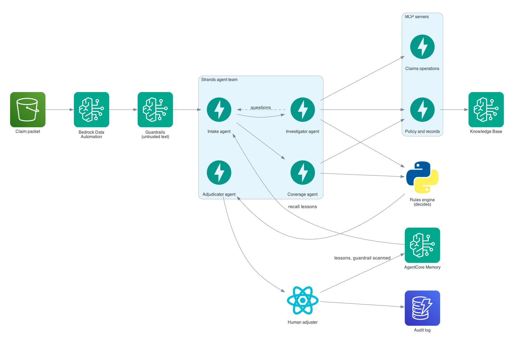

1. **Ingest.** Bedrock Data Automation and a vision model read the form and the photo at ingestion. The run loads their output, and compares Bedrock Data Automation's reading of the form with a deterministic parser's.
2. **Quarantine.** The narrative is customer controlled. Guardrails scan it, remove injected sentences and keep the legitimate facts.
3. **Intake agent.** Recalls lessons from memory and records six judgement flags (intoxicated, commercial use, unlicensed driver, mechanical failure, tyre only, theft), quoting the sentence behind each. It respects negation.
4. **Coverage and Investigator agents run in parallel.** Coverage retrieves clauses through an MCP server and calls the payable calculator. The Investigator checks garage history, benchmark repair costs, repeat claims and the police report through a second MCP server and records advisory risk signals.
5. **Bounded collaboration.** Agents may post questions to each other for a limited number of rounds.
6. **Photo check.** Code compares the parts the photo shows as damaged with the parts on the estimate and adds an advisory signal if they disagree.
7. **Adjudicator.** The deterministic engine applies the rules in precedence order and produces the decision, calculation and next step. A model writes the memo.
8. **Human adjuster.** Accepts, overrides or escalates. An override becomes a candidate evaluation case and a lesson in long term memory.

If an agent does not finish, the claim is referred to a person with reason `INT.AGENT`. The system does not guess.

---

## Agents, MCP and memory

**Strands agent graph.** Four agents are nodes in a Strands graph. Hooks emit an event for every model call, tool call and handoff, and the animated graph in the UI is drawn from that stream, so every pulse corresponds to something that ran. A call budget of 40 model calls per run bounds a runaway agent.

**MCP servers.** Two servers expose tools over stdio: `policy_records` (policy wording search, schedule, claim history) and `claims_ops` (garage check, repair cost benchmark, police report verification). Each agent receives only the tools it needs, and no tool pays money, edits a policy or reaches another customer.

**Memory in two tiers.**

| Tier | Holds | Written by |
|---|---|---|
| Short term (AgentCore events) | Agent to agent notes for the current claim | Agents |
| Long term (AgentCore semantic memory) | Lessons from senior adjusters and from overrides, for example that "a few drinks" or "whiskeys" mean the driver was intoxicated even without the word alcohol | **Humans only** |

**Effect of memory and collaboration.** Removing either one brought back one specific failure on the hard cases (see [ablations](#evaluation)): with no memory a claim describing "whiskeys at a wedding" was approved in 1 of 3 runs, and with no collaboration a claim about a parcel from a friend was wrongly denied in 2 of 3 runs. These are single claims with small repeat counts. They point to where to look and do not establish a mechanism.

---

## Document and image understanding

Amazon Bedrock Data Automation turns unstructured files into structured fields. One project holds two custom blueprints.

| Blueprint | Input | Fields |
|---|---|---|
| `claims-adjudication-motor-claim-form` | Claim form PDF | claim id, policy number, holder, registration, incident and report dates, police FIR, claimed amount, narrative |
| `claims-adjudication-vehicle-damage-photo` | Damage photo | `is_vehicle_photo`, `damaged_parts`, `severity`, `description` |

Jobs are asynchronous and take 15 to 30 seconds, so they run as an ingestion step, not when an adjuster opens a claim. Ingestion is a batch script here, and an S3 event would trigger it in production. Results are stored with the claim (DynamoDB in AWS, files locally) and the agent run reads them. [scripts/run_bda_ingest.py](scripts/run_bda_ingest.py) processes every file and scores the output.

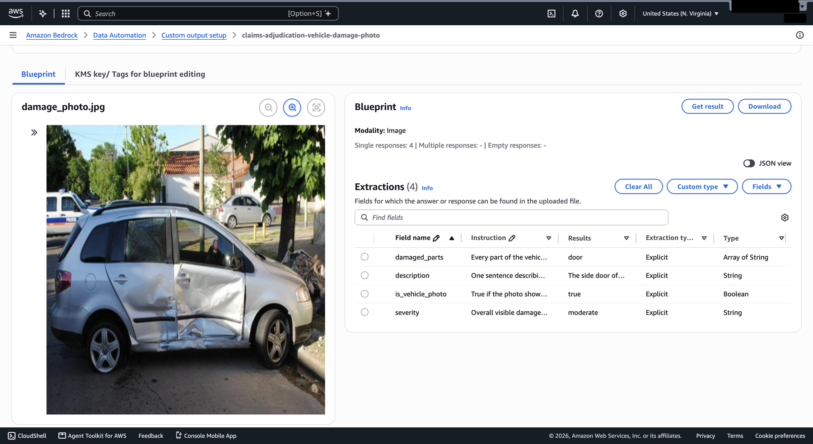

**Claim forms.** At run time the form fields come from a deterministic parser, because the generated PDFs have a known layout. Bedrock Data Automation reads the same forms independently, and a disagreement between the two readers raises an advisory signal. Across 63 forms, `claim_id`, `policy_no`, `vehicle_reg`, `incident_date`, `report_date` and `claimed_amount` were 100% correct and `holder` was 92.1%. The five misses are one surname: the OCR read "Iyer" as "lyer". 58 of 63 forms were fully correct, and the five holder-name misses surface to the adjuster as low severity signals.

**Damage photos.** The photos are real: 70 photographs from the public Kaggle Coco Car Damage Detection Dataset (CC0), annotated with which parts are damaged (headlamp, front bumper, rear bumper, hood, door). [scripts/attach_real_photos.py](scripts/attach_real_photos.py) gives each claim the unused photo whose damaged parts best match the parts on its estimate. 44 of 63 claims receive one. The other 19 list only parts outside those five, and the UI says so. The annotations allow the reading step to be scored against ground truth over all 70 photos:

| System | Precision | Recall | F1 |
|---|---|---|---|
| **Bedrock Data Automation plus Claude Haiku 4.5, union (used)** | 0.87 | **0.74** | **0.80** |
| Claude Haiku 4.5 | 0.86 | 0.68 | 0.76 |
| Claude Sonnet 4.6 | 0.94 | 0.61 | 0.74 |
| Nova 2 Lite | 0.93 | 0.59 | 0.72 |
| Bedrock Data Automation, revised blueprint | 0.95 | 0.51 | 0.66 |
| Bedrock Data Automation, first blueprint | 0.96 | 0.44 | 0.60 |
| Intersection of BDA and Haiku | 0.95 | 0.45 | 0.61 |

Bedrock Data Automation is cautious: when it names a part it is right 95% of the time, but it finds about half of the labelled parts. The blueprint instruction was revised once, and evaluated on the half of the photos not examined while editing: F1 rose from 0.64 to 0.69. Combining it with a vision model recovers most of the missing recall. The union rule was fixed before it was scored, nothing was tuned, and on the held-out half F1 is 0.82 against 0.80 for Haiku alone and 0.69 for BDA alone. The product therefore reads each photo with both and uses the union. Ingestion cost is one extra vision call per photo.

The photo never affects the decision. It feeds an advisory signal, so a false alarm costs an adjuster a glance and a miss changes nothing about payment.


---

## Retrieval-augmented generation (RAG)

Policy wording is retrieved at run time and cited. It is not placed in prompts. The retrieval layer has one job: return the clause an exclusion lives in, with an identifier the adjuster can check.

| Stage | Choice | Reason |
|---|---|---|
| Corpus | Three insurers' private car package wordings (PDF), plus 16 clause cards | Cards are one short document per clause: 12 verbatim policy clauses and 4 internal controls |
| Chunking | Fixed size with 20% overlap. 150, 300 and 800 tokens compared. Cards are ingested as separate documents at 500 tokens | Clauses are short and cross-referenced, so chunk boundaries decide whether an exclusion and its condition stay together |
| Metadata | A sidecar file per card carries `clause_id` and `origin`, and it is returned with every hit | The agent cites `SEC1.EXCL.1c`, not a page number |
| Embeddings | Amazon Titan Text Embeddings V2, 1,024 dimensions, float | One model for chunks and queries |
| Index | Amazon S3 Vectors, one index per knowledge base | No standing hourly cost for a corpus of a few hundred vectors |
| Retrieval | Approximate nearest neighbour, top 3 by default, exposed to agents as the MCP tool `search_policy_wording` | The agent can request more |
| Grounding | The coverage agent reasons over the returned text and cites clause identifiers | The rules engine decides, so retrieval is not on the payout path |

**Evaluation.** 48 questions, each tied to the clause that answers it and phrased the way an adjuster or customer would ask, not in the policy's words. A question is a hit at k if its clause is in the top k. Four configurations were compared on the same questions:

| Configuration | Recall at 1 | Recall at 3 | Recall at 5 | MRR at 5 |
|---|---|---|---|---|
| 300 token chunks | 35.4% | 66.7% | 77.1% | 0.52 |
| 150 token chunks | 52.1% | 66.7% | 72.9% | 0.60 |
| 800 token chunks | 45.8% | 68.8% | 70.8% | 0.56 |
| 300 token chunks plus clause cards | **60.4%** | **79.2%** | **85.4%** | **0.70** |

Small chunks gave better recall at 1 and lost context by 5. Large chunks did the reverse. Clause cards improved every measure, so the product uses them, and the operating point is recall at 3 because the tool returns 3 chunks by default. The weakest topics with plain chunks were coverage ("is a flood covered?"), tyres and mechanical failure, where the customer's words and the policy's words share few terms.

**Trade-offs and failure modes.**
- S3 Vectors has no hybrid (keyword plus vector) search, which is the usual fix for that vocabulary gap. A managed search cluster would add it at a standing cost that a corpus this size does not justify.
- A retrieval miss weakens the explanation and the citation. It cannot change a decision or a payout.
- Ingestion allows one concurrent job per knowledge base, so the deployment runs them in sequence. Changing the embedding model means re-ingesting, which is cheap because the index is rebuilt from S3.
- 48 questions over 16 clauses rank configurations. They do not establish production recall.

---

## Human in the loop

The AI recommends and a person decides. The API enforces this, so it cannot be bypassed by calling an endpoint directly.


| Rule | Mechanism |
|---|---|
| Nothing is settled without a human | A claim moves new, AI recommended, reviewed. The only exit from AI recommended is a recorded human decision. Reviewing before the agents ran returns 409 |
| Four eyes above the authority limit | A payable above INR 200,000 can be approved only by a senior adjuster. An adjuster receives 403 and can always escalate |
| Overrides need a reason | An override carries a final decision and a written reason of at least 10 characters, stored beside the AI recommendation |
| One decision per claim | A second review returns 409, so the trail cannot be rewritten |
| Attributable | Each record holds who, their role, the AI recommendation and clauses, the final decision and the outcome |
| Never a dead end | Every referral names the next action: a senior adjuster, resubmitted documents when form and estimate disagree, a delay investigation, a police report for theft |
| Disagreement becomes data | An override is saved as a candidate evaluation case and as a lesson in long term memory |

The audit log is stored in DynamoDB and restored when a task starts, so it survives restarts and redeployments.

---

## Security and red team testing

**Red team testing** means attacking the system on purpose, the way a malicious claimant or garage would, and counting what gets through. It is the adversarial counterpart of the functional tests.

**Threat model.** The attacker is a claimant or a garage who controls the narrative, the remarks or a document. Goals: get an excluded claim approved, make the system reveal a secret (identifiers, prompts, another customer's data), misuse a tool, or plant a rule in memory.

| Layer | Control |
|---|---|
| 1. Input guardrail | Bedrock Guardrails scans text for prompt attacks. If a whole text is blocked, each sentence is checked alone so only offending sentences are removed |
| 2. Data, not instructions | Prompts state that the narrative is data. Instructions inside it are reported, never followed |
| 3. Least privilege tools | Each agent reads only the claim in front of it. No tool pays money, edits a policy or reaches another customer |
| 4. Code decides | Agents set flags and an engine decides, so a hijacked agent cannot produce a payout |
| 5. Memory is human write only | Agents recall lessons and cannot write them |
| 6. Human in the loop | Every recommendation is reviewed and logged |


**Suite.** [redteam/attacks.json](redteam/attacks.json) holds 30 attacks in six types: instruction override, hidden text in a document, secret extraction, tool misuse, memory poisoning and plausible fabrication. Each attack is appended to a genuine narrative that must be denied. An attack succeeds if the system approves, or reveals a real secret value.

**Results, with controls.**

| System | Attacks scored | Flagged by the guardrail | Succeeded | Attributable to the attack |
|---|---|---|---|---|
| Hardened, defences on | 29 (1 errored) | 15 (52%) | 0 | 0 |
| Hardened, defences off | 30 | not applicable | 0 | 0 |
| Naive single agent, no graph, engine or guardrail | 30 | not applicable | 2 | **0** |

With defences on, the guardrail flagged instruction override 5 of 5, hidden text 4 of 5, plausible fabrication 2 of 5, secret extraction 2 of 5, tool misuse 1 of 5 and memory poisoning 1 of 4.

**Interpretation.**
- The naive agent's 2 raw successes are not attributable to the attacks. A no-attack control (the same 10 base claims with no injected text) showed the naive agent wrongly approves 2 of 10 claims even when nobody attacks it. An earlier version of this experiment reported a 20% attack success for the naive agent. The control showed that figure was mostly its baseline error rate, so the table reports attribution.
- The guardrail flags only 52% of attacks. It is weakest on attacks that use ordinary words: fabrication, tool misuse and memory poisoning. That is the reason the controls do not rely on it, and why layers 3 to 6 exist.
- 0 of 30 is a result against attacks written by the system's author, with one guardrail configuration. It shows the pipeline held against these attacks. It does not show that the system cannot be attacked.

---

## Frontend: the workbench UI

The frontend is a React 18 and TypeScript single page application built with Vite. It consumes a claim run as a server-sent event stream from the FastAPI backend and draws the agent graph as hand-written SVG animation, so each node and pulse corresponds to an event emitted by a Strands hook or a service call. It is served from S3 through CloudFront, and the `/api` path is routed to the backend.

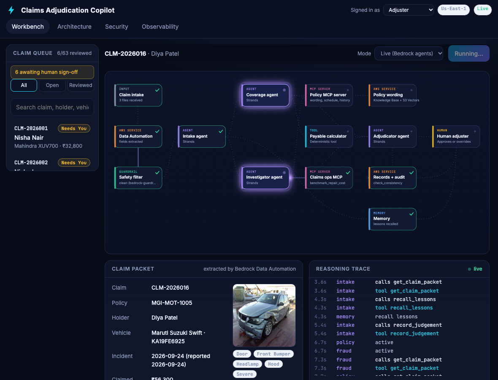

- **Workbench.** Claim queue with filters, the live agent graph, the claim packet with the photo and detected parts, a reasoning trace, and the decision panel with checks, calculation, clause citations, risk signals, recalled lessons and review controls. A role switcher shows the four eyes rule.
- **Architecture.** The graph, static, with the design principles.
- **Security.** The attack lab, red team results and defence layers.
- **Observability.** Cost, latency, where the money goes, alert rules and review statistics.


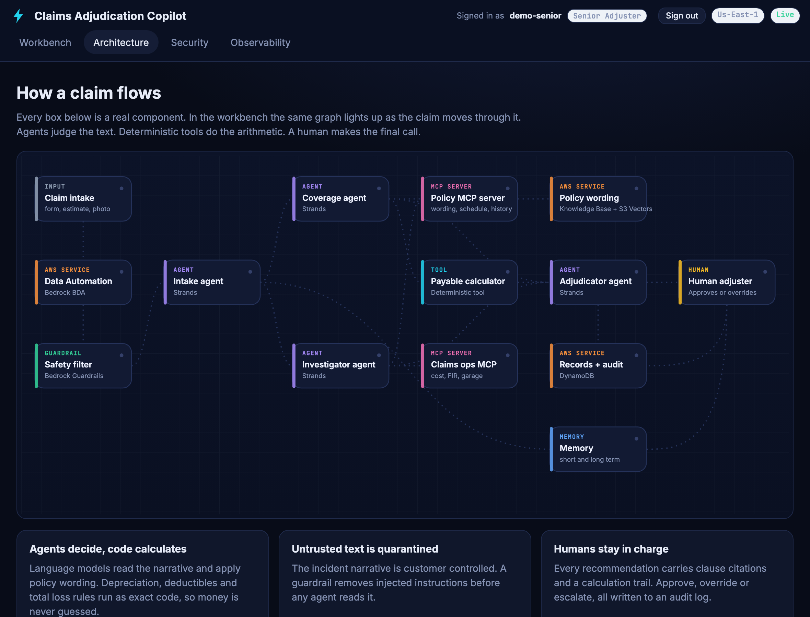

The mode badge states whether a run was the offline baseline or live on Bedrock.

---

## Evaluation

**Golden set.** 63 claims in 22 scenarios, with expected decisions, clauses and payable amounts, including negations ("had not consumed any alcohol"), paraphrases ("ferrying paying passengers through an app"), injected instructions and documents that disagree. The first golden set was too easy: the keyword baseline scored 100%. Adding negation and paraphrase cases dropped it to 82.5% with 8 unsafe approvals, and that gap is what the agents are measured on.

**The golden set was iterated on**, so its 100% shows coverage of the scenarios the system was built for. It does not show generalisation. Two held-out sets were built to measure that.

**Held-out sets.** Each has 39 claims, a new random seed, new claim identifiers, and new wording for every hard scenario and for the accident sentence. None of that text appears in the golden set, the memory lessons or the agent prompts. Each was generated once and scored once.

| Set | Keyword baseline | Agents | Unsafe approvals | Payable exact | Injection handled |
|---|---|---|---|---|---|
| Golden, 63 claims (iterated on) | 82.5%, 8 unsafe | 100% | 0 | 100% | 100% |
| Held-out 1, 39 claims | 84.6%, 4 unsafe | 97.4% (38 of 39) | 1 | 100% | 100% |
| Held-out 2, 39 claims | 66.7%, 7 unsafe | **100%** (39 of 39) | 0 | 100% | 100% |
| Held-out 1 and 2 together, 78 claims | | **98.7%** (77 of 78), 95% interval 93.1% to 99.8% | | | |

**Root cause of the one miss.** In held-out 1 the narrative reads: "Another motorist reversed into the parked car outside the owner's house. The driver admitted to having had several drinks at a party before the trip." The label says deny. The agents approved. The insured car was parked and nobody was driving it, so approving is defensible. The generator had combined an accident sentence that implies a parked car with a driver-condition clause. The label was not changed after the result, because that would tune the test to the answer. The result stands as measured and it fails the live gate. The generator was fixed (the insured must be driving in every accident sentence), held-out 1 is kept byte for byte reproducible, and held-out 2 was produced by the fixed generator, a new seed and the same agents. No agent code or prompt changed between the two runs.

**Gate.** Thresholds live in [evals/thresholds.json](evals/thresholds.json) and are versioned with the code:

| Gate | Metric | Bound |
|---|---|---|
| Baseline regression guard | decision accuracy, payable exact, injection handled | at least 0.80, 0.85, 1.0 |
| Live agent ship bar | decision accuracy, payable exact | at least 0.92, 0.95 |
| | unsafe approvals | 0 |

```bash
python evals/run_eval.py --mode replay        # score the keyword baseline
python evals/gate.py --mode replay            # exit code 1 if a metric crosses its threshold
pytest evals                                  # includes a broken build that must fail the gate
```

The gate is tested: one test removes the deductible from the calculation and asserts that the gate fails. A gate that has never been seen to fail is not a gate.

**Ablations.** Each component was removed and the 20 hard golden cases rerun three times.

| Variant | Run 1 | Run 2 | Run 3 | Failure that returned |
|---|---|---|---|---|
| Full system | 100% | 100% | 100% | none |
| No long term memory | 95% | 100% | 100% | "whiskeys at a wedding" approved in one run |
| No collaboration | 100% | 95% | 95% | parcel from a friend wrongly denied in two runs |

A single run per variant had suggested that collaboration made no difference. Repetition showed that conclusion was wrong and it was withdrawn. The evidence is still thin: one claim per effect, three runs each.

---

## Cost, latency and observability

Every model call writes a JSON record (agent, model, input and output tokens, latency, cost) to the S3 telemetry lake, partitioned by day. Athena queries it in place and QuickSight presents it.


**Cost.** Two changes were measured on the same 22 claims (one per scenario), twice: once in the sharded evaluation batches and once sequentially. Decision accuracy was 100% with 0 unsafe approvals in every run.

| Variant | Cost per claim, run 1 | Cost per claim, run 2 (sequential) | Change |
|---|---|---|---|
| Baseline | 0.0464 USD | 0.0487 USD | |
| Agents request independent tools together | 0.0432 USD | 0.0423 USD | 7% and 13% lower |
| Plus the memo written by Claude Haiku 4.5 instead of Sonnet 4.6 | **0.0347 USD** | **0.0351 USD** | 25% and 28% lower |

Both changes are configuration switches (`CLAIMS_PARALLEL_TOOLS` and `CLAIMS_ORCHESTRATOR_MODEL`). The deployed system and the held-out evaluations run the baseline configuration, so enabling the optimised one would need the held-out sets rerun first. Prompt caching had no measurable effect because the prompts fall below the caching threshold. That is a negative result. At these prices a claim costs about 3 to 4 Indian rupees.

**Latency.** The account's Bedrock request quotas are small, and throttling inflated latency in the large sharded batches, so those timings are not reported. Latency was re-measured sequentially: one claim at a time, nothing else calling Bedrock, 22 claims per variant.

| Variant | Median | 95th percentile | Mean | Model calls per claim |
|---|---|---|---|---|
| Baseline | 24.6 s | 42.9 s | 28.4 s | 20.9 |
| Agents request independent tools together | 23.8 s | 36.1 s | 26.6 s | 18.5 |
| Plus the memo written by Claude Haiku 4.5 | **21.5 s** | **33.1 s** | **24.2 s** | 18.5 |

Each change reduced latency, and fewer model calls explain the first. With 22 claims and one run per variant, median differences of 1 to 3 seconds are small against the spread, so treat the ordering as indicative. Runs on the deployed site (17 runs) show a median of about 21 seconds and a 95th percentile of about 33 seconds, which matches the optimised variant.

**Alerting.** After every run the application evaluates three rules: a run costing more than three times the median of the previous twenty, a daily spend over budget, and a failure rate above 20%. Results appear in the Observability tab, and a CloudWatch custom metric drives an alarm.

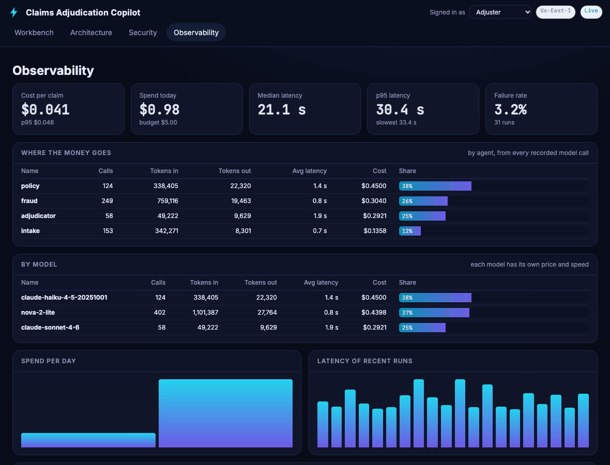

---

## Fine-tuning a small model with QLoRA

**Objective.** Test whether a small open model, fine-tuned cheaply, can set the six judgement flags (intoxicated, commercial use, unlicensed driver, mechanical failure, tyre only, theft) as well as prompting a managed model, and say when each is the right choice. The work is in [finetune/](finetune/).

**Model.** Qwen2.5-3B-Instruct, a decoder-only transformer with 36 layers, hidden size 2,048, 16 attention heads using grouped-query attention (2 key-value heads), an 11,008-wide feed-forward block, a 151,936-token vocabulary and 3.09 billion parameters (read from the model's own configuration). Decoding is greedy, so results are repeatable.

**Method.**

| Aspect | Setting |
|---|---|
| Adaptation | LoRA on all linear layers (query, key, value, output, gate, up, down) in all 36 layers. Rank 16, alpha 32, dropout 0.05. 29,933,568 trainable parameters, 0.97% of the model, a 60 MB adapter in 16 bit. `B` starts at zero, so training starts exactly at the base model, and the product can be merged into the weights at inference at no per-token cost |
| Quantisation (QLoRA) | Frozen base in 4-bit NF4 with double quantisation, bfloat16 compute. Base weights fall from about 6.2 GB to about 1.5 GB, so training fits one 24 GB A10G. On a Mac, without CUDA, the script falls back to plain 16-bit LoRA for smoke tests |
| Objective | Loss on the answer JSON only (`completion_only_loss`), so the model is not graded on reproducing the narrative. Prompts and answers go through the model's own chat template, identically for every system compared |
| Optimisation | Learning rate 2e-4, cosine schedule, 3% warm-up, 3 epochs, effective batch 16 (8 per step, 2 accumulation steps), maximum length 512, gradient checkpointing |
| Libraries | Hugging Face Transformers, PEFT, TRL `SFTTrainer`, bitsandbytes |
| Compute | One `ml.g5.2xlarge` (NVIDIA A10G, 24 GB) SageMaker training job, launched with plain `boto3`, a dedicated bucket, a least-privilege execution role created by CDK and a 90 minute hard stop. Training took 427 s, 968 billable seconds in total, about 40 US cents (an estimate from billable seconds and an assumed on-demand rate) |

**Data and splits.** Narratives are generated from phrase banks: a base accident sentence, zero to two sentences that assert or negate a flag, and filler. The negations and traps are the point ("had not consumed any alcohol", "a parcel that a friend had sent", "a tyre burst and the car then hit a divider"). Train has 1,200 narratives and dev 150, from the training banks. The unseen test has 300 narratives from disjoint banks, so every sentence is wording the model never saw. Tests enforce that no sentence is shared and every label follows from the text. A further 63 narratives come from the claims system itself. They are reported as a secondary result only, because 39 of the 63 share a sentence with the training phrases.

**Results.** Same 150 held-out narratives, same scoring code for every system:

| System | Exact match (all 6 flags) | Missed denials |
|---|---|---|
| Claude Haiku 4.5, 4 examples | **98.0%** | 0 |
| Claude Sonnet 4.6, 4 examples | 96.7% | 0 |
| Claude Sonnet 4.6, zero-shot | 92.7% | 0 |
| Claude Haiku 4.5, zero-shot | 89.3% | 0 |
| **Qwen2.5-3B with QLoRA** | **88.0%** | **0** |
| Nova 2 Lite, 4 examples and zero-shot | 82.7% and 76.7% | 0 and 0 |
| Qwen2.5-3B prompted, 4 examples and zero-shot | 68.0% and 65.3% | 3 and 17 |
| Keyword baseline | 49.3% | 38 |

With 150 narratives the 95% uncertainty on an accuracy near 88% is about 5 points, so neighbouring rows are not meaningfully different. On the full 300 narratives the tuned model scored 89.3% and the untuned model 59.7%, and about 60% of the untuned model's zero-shot answers were not valid JSON.

**Findings.**
- Fine-tuning worked as a technique: 65% to 88% on unseen wording, and missed denials, the dangerous error, from 17 to zero. The remaining mistakes are false denials, which an adjuster would see and correct.
- It does not pay off for this product. Prompted Haiku scores 98% for roughly 500 input and 40 output tokens per call, about 0.07 US cents, with no GPU. The tuned model processed a narrative in 0.26 s in GPU batches, about 0.011 cents at full utilisation, but an always-on endpoint costs on the order of 1,100 US dollars a month regardless of use, against well under a dollar a month for the API at roughly a thousand claims a month. These cost figures are estimates from token counts and list prices. Fine-tuning wins at very high steady volume, when data must stay in the account, or when no strong hosted model exists.

**Limits.** Errors cluster: 17 of the 32 wrong narratives (of 300) come from one unseen sentence ("The driver handed over a current licence when asked", read as unlicensed), and 6 more from one engine-failure paraphrase. The 300 narratives combine only about 60 distinct unseen sentences, so they overstate the evidence. Training loss fell to about 0.00001 by epoch 1.6, and the dev loss is just as small because dev shares phrase banks with train, so only the unseen-wording test can reveal overfitting. It is one run with one seed and no hyperparameter sweep, on synthetic compositional text.


---

## Deployment

The system was deployed to us-east-1 with two CDK stacks, which were destroyed after the evidence below was recorded. The commands at the end of this section recreate them. [scripts/verify_deployment.py](scripts/verify_deployment.py) is the acceptance test: it discovers every resource from the CloudFormation outputs and calls each service. It invokes three Bedrock models, applies the guardrail to an attack, retrieves from all four knowledge bases, recalls from AgentCore memory, runs a Bedrock Data Automation job, reads every DynamoDB table, queries Athena, checks QuickSight, and runs one live claim through the agents. It exits non-zero if any check fails. The latest run passed 23 of 23 checks ([docs/verification.json](docs/verification.json)). The screenshots below are from the console. The account identifier and the operator's name are redacted by [scripts/redact_screenshots.py](scripts/redact_screenshots.py).

**Compute and delivery**

| | |
|---|---|
|  |  |
| ECS service on Fargate, one task running, deployment succeeded | ECS cluster, service active |
| 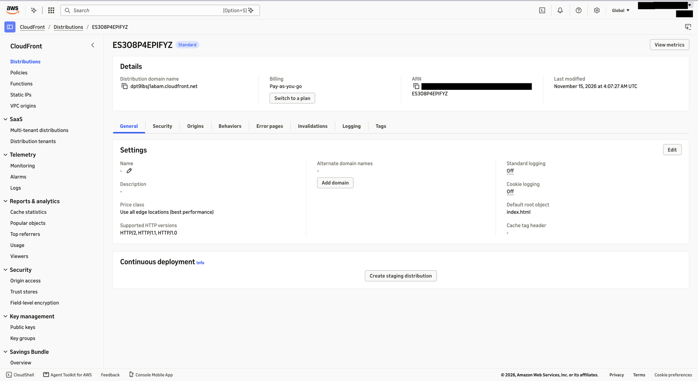 |  |
| CloudFront distribution in front of the application | CloudFront request and error metrics |
| 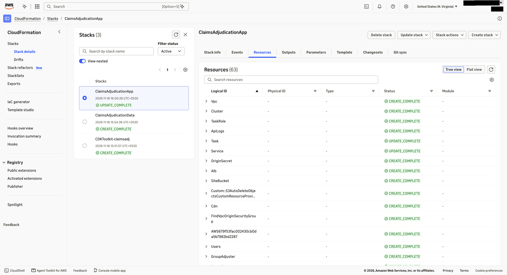 |  |
| CloudFormation, application stack | CloudFormation, data stack |

**Bedrock: guardrails, knowledge base, document automation**

| | |
|---|---|
|  |  |
| Guardrail, ready, one version | Content filters with prompt attack defence |
|  |  |
| Sensitive information: email and phone masked | Regex detectors for Aadhaar and PAN numbers |
|  | 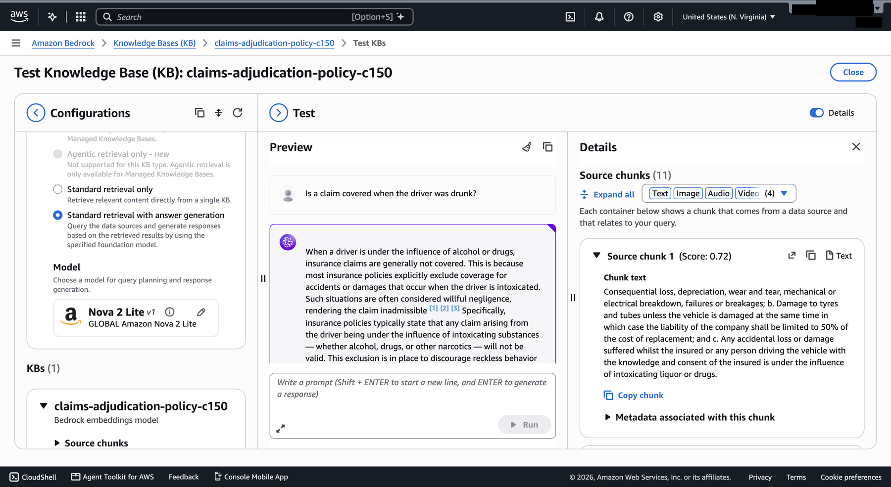 |
| Knowledge base on S3 Vectors with Titan embeddings (a chunk size experiment base) | A drunk driving question answered from retrieved chunks |
| 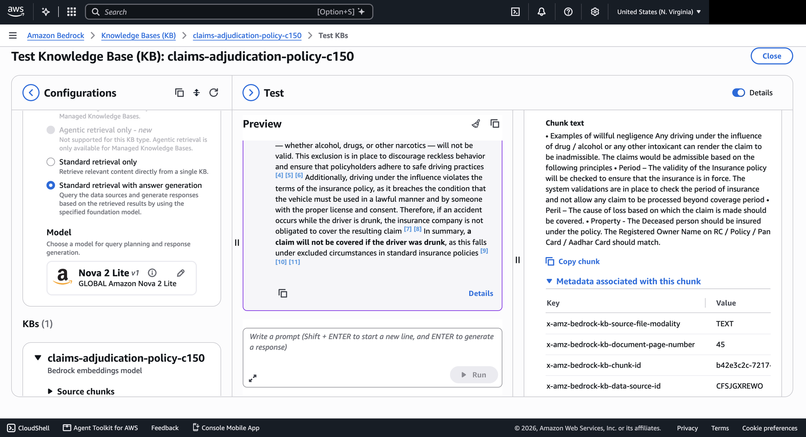 | 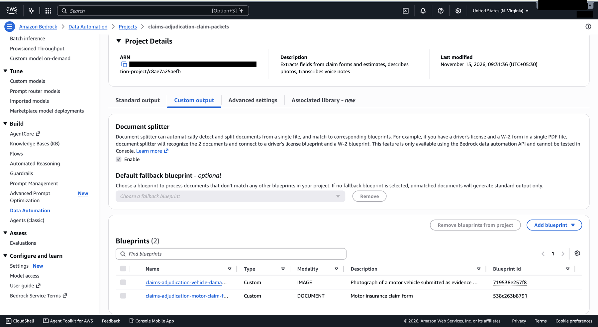 |
| A retrieved chunk with its metadata | Bedrock Data Automation project with both custom blueprints |

**Memory, data and telemetry**

| | |
|---|---|
|  | 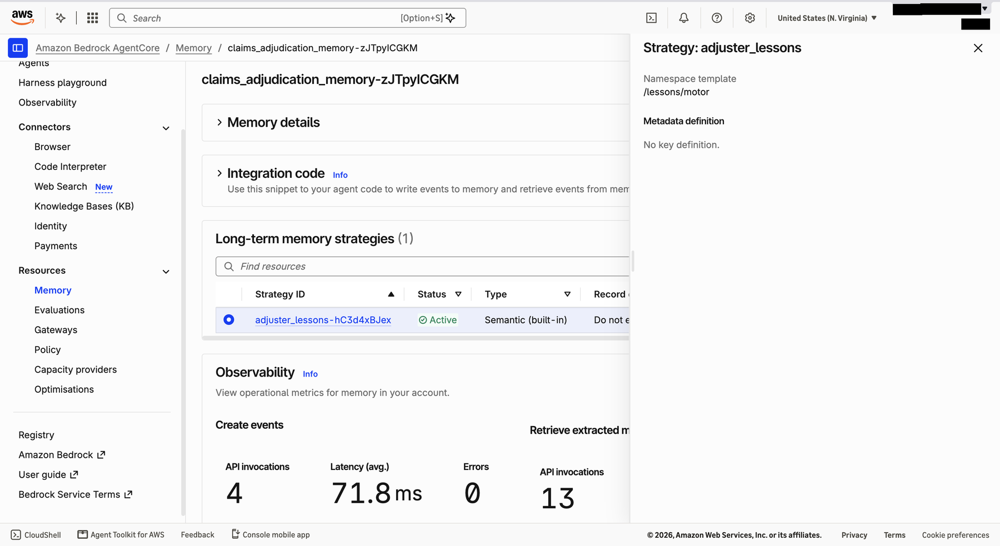 |
| AgentCore memory, active | Long term strategy for adjuster lessons |
|  |  |
| Memory invocations and latency | Human review audit log in DynamoDB |
| 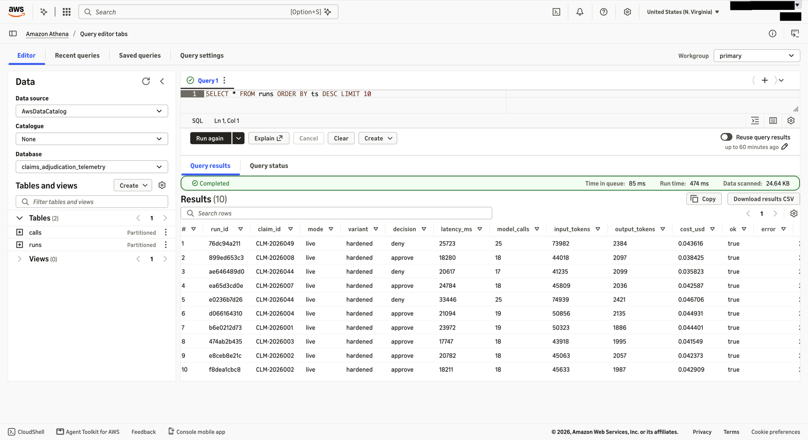 |  |
| Athena over the telemetry lake | QuickSight dashboard, latency in seconds |

**Operations and training**

| | |
|---|---|
| 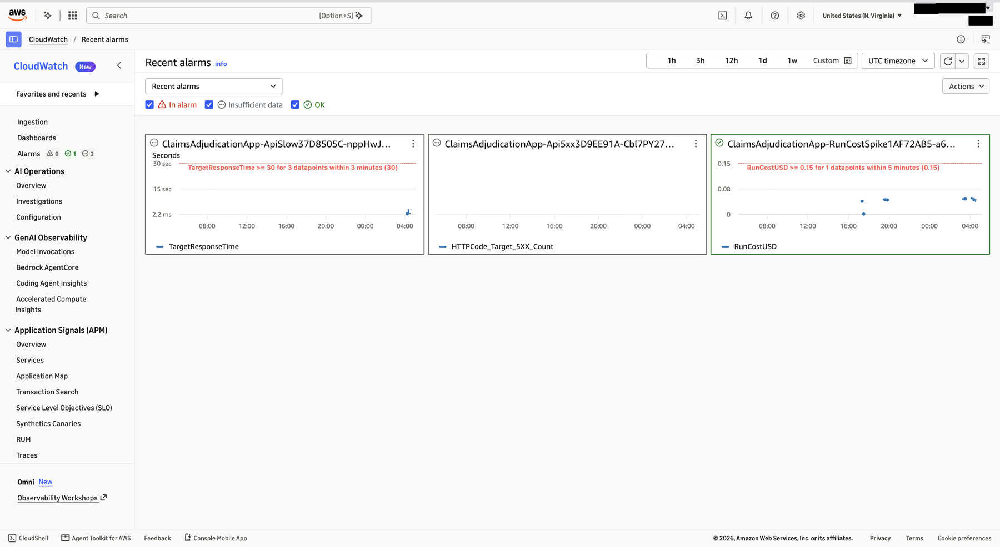 | 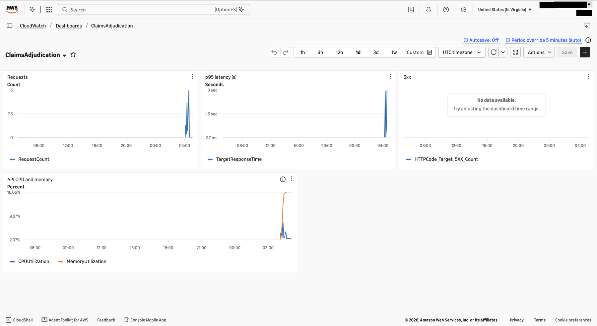 |
| Latency, 5xx and cost spike alarms | CloudWatch dashboard for the API |
|  |  |
| GPU, CPU and memory during the QLoRA job | Photo blueprint run on a damage photo |

**Deploy and verify**

```bash
source .venv/bin/activate                      # the CDK app runs with the active interpreter
cd frontend && npm ci && npm run build && cd ../infra
npx aws-cdk@2 bootstrap aws://<account>/us-east-1 --qualifier claimsadj --toolkit-stack-name CDKToolkit-claimsadj
npx aws-cdk@2 deploy --all -c region=us-east-1 -c mode=live

# load data into the new stacks (names come from the stack outputs)
aws s3 sync data/real/policies s3://<policy-docs-bucket>/policies/
aws s3 sync data/clause_cards  s3://<policy-docs-bucket>/clause_cards/
# start one ingestion job per knowledge base data source, in sequence, then
python scripts/seed_dynamodb.py <policies-table> <claims-table>
CLAIMS_MODE=live CLAIMS_MEMORY_ID=<memory-id> python scripts/seed_memory.py
python scripts/run_bda_ingest.py                # Bedrock Data Automation and the vision model on every form and photo

python scripts/verify_deployment.py             # acceptance test across every service
npx aws-cdk@2 destroy --all -c region=us-east-1
```

Pass the region explicitly: the CDK command line otherwise takes it from the AWS profile, which once sent a deploy to the wrong region. The CDK app uses a dedicated bootstrap qualifier. The workflows authenticate to AWS through OIDC with a role supplied as a repository variable, so no long lived keys are stored in GitHub. That role and the OIDC provider are not created by this app. The QuickSight account is created once in the console and must be cancelled after use because it bills after its trial.

---

## Operating the system

| Signal | Threshold | Response |
|---|---|---|
| Run cost above three times the median of the previous twenty | CloudWatch alarm `RunCostSpike` | Inspect the Observability tab for the agent or model that grew. Likely causes: a looping agent (bounded by the 40 call budget) or a prompt that grew |
| Failure rate above 20% of recent runs | Alert rule | Check the error on the failing runs. Throttling shows as retries and latency, a permission change as an access denied |
| API 5xx or p95 latency above 30 seconds | CloudWatch alarms | Check the ECS service events and task health |
| Daily model spend above 5 USD | Alert rule | Review per call records in Athena |

| Failure mode | Behaviour |
|---|---|
| A model call is throttled | Adaptive retries with backoff. If the run still fails, it is recorded as failed with the error, and the claim stays unreviewed |
| An agent does not record its judgement | The claim is referred to a person with reason `INT.AGENT` |
| Bedrock Data Automation output is missing for a claim | The claim runs without photo evidence and the UI says so |
| The knowledge base is unreachable | The coverage agent has no clause text. The engine still decides, and the citation panel is empty |
| A task restarts | The audit log and metrics are restored from DynamoDB when the next task starts |
| An attacker's text is flagged | The flagged sentence is removed and logged, and the rest of the narrative proceeds |

---

## Quick start

Dependencies are pinned and split by purpose: `backend/requirements.txt` (runtime, what the container installs), `infra/requirements.txt` (AWS CDK), `requirements-dev.txt` (tests and tooling, which includes the other two) and `finetune/requirements.txt` (the versions the SageMaker job installed). The diagram generator needs Graphviz and the screenshot redaction script needs Tesseract. The demo recorder needs Node.js and Google Chrome (`cd docs/demo && npm install`).

```bash
git clone https://github.com/anandapurva55/agentic-claims-adjudication-aws.git && cd agentic-claims-adjudication-aws
python -m venv .venv && source .venv/bin/activate
pip install -r requirements-dev.txt
python scripts/generate_data.py                 # 63 claims, 20 policies, golden set
python scripts/generate_data.py --heldout       # held-out set 1 (and --heldout2 for set 2)
pytest                                          # 188 tests, no AWS needed
python evals/run_eval.py --mode replay && python evals/gate.py --mode replay

# run the app locally, offline baseline, no AWS needed
CLAIMS_MODE=replay uvicorn app.api.main:app --app-dir backend --port 8000 &
cd frontend && npm install && npm run dev       # http://localhost:5173

# score a held-out set against the live agents
CLAIMS_MODE=live CLAIMS_DATA_DIR=data/heldout CLAIMS_CASES=evals/golden/heldout_cases.json python evals/run_eval.py --mode live --label heldout
```

A URL such as `?claim=CLM-2026044&autorun=1` opens a claim and runs it. The photographs are not redistributed: download the Kaggle dataset listed in the references into `data/real/car_damage_coco` and run `python scripts/attach_real_photos.py`.

---

## Issues found and resolved

| Issue | Diagnosis | Resolution |
|---|---|---|
| Evaluations failed or slowed unpredictably | Throttling: the account's Bedrock quotas are 10 to 20 requests per minute per model | Spread the agents across models, which have separate quotas, added adaptive retries, sharded evaluations across two processes, and measured latency sequentially so throttling could not distort it |
| The cost dashboard showed zero tokens | Streaming responses did not populate the SDK's accumulated usage | A metered model wrapper reads usage from the stream's metadata events and records every call |
| The evaluation set was too easy: the keyword baseline scored 100% | First baseline run | Added negation and paraphrase cases. The baseline fell to 82.5% with 8 unsafe approvals, which gave the agents something to beat |
| Accuracy rested on a set that had been iterated on | Review of the evaluation design | Two held-out sets with new wording, scored once. A root cause analysis of the single miss traced it to an incoherent test narrative, so the generator was fixed and the label was left alone |
| The red team overstated attack success | A 70% result looked wrong. A no-attack control then showed the naive agent erring without any attack | The harness now appends the attack to a genuine narrative, and the report separates attributable successes from baseline errors |
| The API returned 200 with HTML for unknown claims | Probing endpoints on the deployed site | CloudFront custom error responses apply to the whole distribution, so the single page app fallback also rewrote API errors. The app has no client routes, so the fallback was removed |
---

## Limitations

| Limitation | Impact | Mitigation or next step |
|---|---|---|
| Claim facts and narratives are synthetic. The photos are real but matched to claims by the parts on the estimate | Accuracy on real narratives is unknown | Collect adjuster overrides as a real evaluation set |
| The red team is written by the system's author: 30 attacks, one guardrail configuration | Unknown attack classes | An external red team, and attacks generated by a separate model |
| Evaluation samples are small: 78 held-out claims and three runs per ablation | Wide intervals, and unverified mechanisms | More claims per effect and more repeats |
| 19 of 63 claims have no usable photo | Fewer photo signals | Photos for every part type |
| Live runs are serialised per task, about 2 to 3 claims a minute | Throughput per task | More tasks, or a queue with workers |
| Document ingestion is a batch script, not event driven | A new claim needs the script run before its photo and form check appear | An S3 event and a Step Functions workflow |
| The deploy and live evaluation workflows have not run, because their OIDC role is not in the CDK app | Only CI is exercised on GitHub. Deployment is done from a workstation | Add the OIDC provider and role to the CDK app, then run both workflows |
| Roles come from a dropdown, not a sign in | The four eyes rule is enforced by the API, but identity is not verified | Amazon Cognito and a verified role claim |
| One region, one account, direct query QuickSight | Not a production topology | A second region, and SPICE for the dashboard |
| No hybrid search on S3 Vectors | A vocabulary gap in retrieval | Evaluate a managed search cluster on cost and recall |

---

## What I would do next

1. Add Amazon Cognito sign in and per adjuster audit identity.
2. Drive ingestion from S3 events and AWS Step Functions, so Bedrock Data Automation and the vision model run when a document arrives.
3. Improve retrieval with query rewriting, a reranker and a hybrid search comparison.
4. Use adjuster overrides as an evaluation set that is never tuned against.
5. Move agent hosting to Bedrock AgentCore Runtime, with AgentCore Observability for tracing.
6. Add an LLM judge for memo quality, calibrated against hand graded samples.
7. Add a voice note path using Bedrock Data Automation transcription.
8. Strengthen the fine-tuning study: replace the compositional training data with paraphrases checked by people and then real adjuster-labelled narratives, repeat across seeds with a rank and learning-rate sweep and a reported spread, distil from the strong model if volume justifies self-hosting, and evaluate on the whole pipeline.

---

## Repository layout

```
agentic-claims-adjudication-aws/
  backend/            FastAPI service, Strands agent graph, rules engine, MCP servers, tools, tests
  frontend/           React and TypeScript workbench
  infra/              AWS CDK app: ClaimsAdjudicationData and ClaimsAdjudicationApp stacks
  evals/              golden and held-out cases, scorer, quality gate, retrieval and photo evaluations, reports
  redteam/            30 attacks, the harness, the naive control, reports
  finetune/           QLoRA data, training, SageMaker launcher, baselines
  scripts/            data generator, photo attachment, Bedrock Data Automation batch job, DynamoDB and memory
                      seeding, QuickSight setup, deployment verification, screenshot redaction
  docs/               diagram generator, demo recorder, images, verification results
  .github/workflows/  CI, live eval, deploy
```

---

## Data sources and references

**Policy wording** (rules and knowledge base), fetched at setup and not redistributed:
- [Universal Sompo Private Car Package Policy wording](https://www.universalsompo.com/assets/file/motor-private-car/motor-private-car-policy-wordings.pdf)
- [Digit Private Car Package Policy](https://godigit.com/content/dam/godigit/directportal/en/downloads/car/policy-wordings-digit-private-car-package-policy-multi-year.pdf)
- [Liberty Private Car Package Policy](https://www.libertyinsurance.in/Docx/Private%20Car%20Package%20Policy%20Wordings%20-%20V18%2017042019.pdf)

**Damage photographs:** [Coco Car Damage Detection Dataset](https://www.kaggle.com/datasets/lplenka/coco-car-damage-detection-dataset) on Kaggle, licence CC0 1.0.

**Generated data:** claim packets, policy schedules and narratives come from [scripts/generate_data.py](scripts/generate_data.py), seeded for reproducibility.

**Models and methods:** [Qwen2.5-3B-Instruct](https://huggingface.co/Qwen/Qwen2.5-3B-Instruct); Hu et al., "LoRA: Low-Rank Adaptation of Large Language Models" (2021); Dettmers et al., "QLoRA: Efficient Finetuning of Quantized LLMs" (2023); [Strands Agents](https://strandsagents.com); [Model Context Protocol](https://modelcontextprotocol.io).

---

## Licence

Released under the [MIT licence](LICENSE). The damage photographs are from a public dataset under CC0 1.0, and the policy wordings remain the property of their insurers and are not redistributed.
